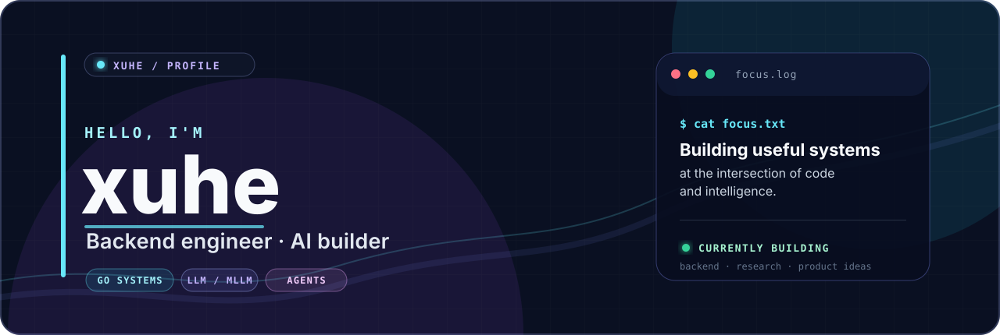

  

  
  
  

<table>
  <tr>
    <td width="56%" valign="top">
      <h2>🧑‍💻 关于我</h2>
      
我是一名关注 <strong>开源开发</strong>、<strong>后端工程</strong> 与 <strong>AI 研究</strong> 的工程师，喜欢把新想法做成可运行、可复用的系统。

      <ul>
        <li><strong>LLM / MLLM</strong>：理解模型原理与前沿方法，持续把研究落到实践。</li>
        <li><strong>后端开发</strong>：主要使用 <strong>Go</strong> 构建服务，关注性能、可靠性与工程质量。</li>
        <li><strong>Agent 应用</strong>：探索工具调用和自动化工作流，解决真实世界的问题。</li>
        <li><strong>AI 科研辅助</strong>：与伙伴一起用 AI 探索科学任务，沉淀可复用的研究想法。</li>
      </ul>
    </td>
    <td width="44%" valign="top">
      <h2>📡 GitHub 信号</h2>
      

        
      

      

        
      

    </td>
  </tr>
</table>

<h2>✨ Featured project</h2>

<table>
  <tr>
    <td width="70%" valign="top">
      <h3><a href="https://github.com/yogsoth-ai/de-anthropocentric-research-engine">DARE · De-Anthropocentric Research Engine</a></h3>
      
一个与伙伴共同探索的 AI 科研辅助项目：让智能体参与问题拆解、资料检索与研究想法沉淀，帮助把模糊的好奇心推进成可验证的方向。

      

        
        
        
      

    </td>
    <td width="30%" valign="middle" align="center">
      
    </td>
  </tr>
</table>

<h2>🧰 Toolkit</h2>

<strong>Languages</strong> 
  

<strong>AI &amp; Research</strong> 
  

<strong>Engineering</strong> 
  

<h2>🌱 What I'm exploring</h2>

  
  
  
  

  <em>欢迎交流模型研究、工程实践与产品想法。一起把好奇心变成可运行的东西。</em>

  

